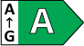
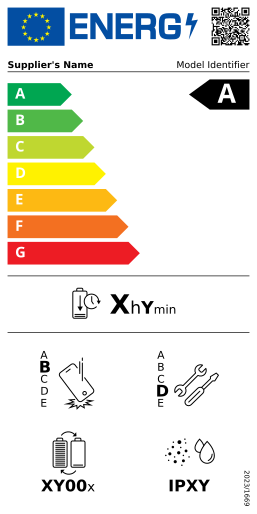

# Energy ⚡ Label Generator

A JavaScript/TypeScript library for generating EU-compliant energy labels as SVG, in Node.js and in the browser.

[](https://www.npmjs.com/package/energy-label)
[](https://github.com/marcmarine/energy-label/blob/main/LICENSE)
[](https://github.com/marcmarine/energy-label/releases)

[](https://docs.label.energy)
[](https://studio.label.energy)

## Class Arrow



```js
import { renderClassArrow } from 'energy-label'

const svgString = renderClassArrow('A', { labelOrientation: 'LEFT' })
```

## Smartphone Label



```js
import { renderSmartphonesLabel } from 'energy-label'

const svgString = renderSmartphonesLabel()
```

## Features

- Generate SVG energy labels following official **EU regulations**.
- Use **product data from EPREL as is**: field names and units match the EPREL API.
- **Zero runtime dependencies** and compact SVG output.
- **Tree-shakeable**: bundle only the labels you use.
- Works in both **Node.js** and **modern browsers**, synchronously.
- Supports flags for both **European Union** (🇪🇺) and **Great Britain** (🇬🇧) markets.
- **Typed data** for each template in TypeScript.
- Compatible with **any JavaScript framework**, including **React**, **Vue**, **Svelte**, **Angular**, and more.

> [!NOTE]
> It is currently available for smartphones and tablets, refrigerating appliances (household fridges and freezers, and wine storage appliances) and class arrows. More templates will be added gradually.

## Installation

```bash
npm install energy-label
```

See our [documentation](https://docs.label.energy) for more installation methods.

## Basic Usage

### Node.js

You can generate an energy label and save it as an SVG file using Node.js:

```js
import { EnergyLabel } from 'energy-label'
import fs from 'node:fs'

const label = new EnergyLabel('smartphones')

const svgString = label.toString()
fs.writeFileSync('smartphone-label.svg', svgString)
```

Missing fields are shown as placeholders (such as `XYZ`), so you can preview a label before having all its data.

### Using EPREL Data

The data fields use the same names and units as the [EPREL](https://eprel.ec.europa.eu) public API, so a product's data can be passed as it comes. Fields the label doesn't need are ignored.

The EPREL API doesn't allow requests from browsers (CORS), so fetch the data on your server, as in this Node.js example:

```js
import { createEnergyLabel } from 'energy-label'

const response = await fetch('https://eprel.ec.europa.eu/api/product/1573269')
const product = await response.json()

const label = createEnergyLabel('refrigerating-appliances', product)
const svgString = label.toString()
```

To fetch EPREL data from the browser, you can host [eprel-api-proxy](https://github.com/marcmarine/eprel-api-proxy), a small proxy that forwards requests to the EPREL API and adds the CORS headers:

```js
// Requests to the proxy are forwarded to https://eprel.ec.europa.eu/api
const response = await fetch(
  'https://your-eprel-proxy.example.com/product/1573269',
)
const product = await response.json()

const label = createEnergyLabel('refrigerating-appliances', product)
```

> [!TIP]
> Set `CORS_ORIGIN` to your site's origin so other sites can't use your proxy from their pages.

The data also decides the variant of the label: a refrigerating appliance with `capBottles` gets the wine storage label, and a freezer without a fridge compartment shows only the freezer capacity.

The QR code links to the product in EPREL, with the same URL as the official labels. Without `eprelRegistrationNumber`, it links to the product group page.

### Browser

#### Create and Display an Energy Label

Display energy labels directly in web pages using HTML and JavaScript.

```html
<!DOCTYPE html>
<html>
  <head>
    <title>Simple Energy Label</title>
  </head>
  <body>
    <div id="label-container"></div>

    <script type="module">
      import {
        createEnergyLabel,
        appendTo,
      } from 'https://esm.sh/energy-label'

      const label = createEnergyLabel('smartphones')

      const svgString = label.toString()
      appendTo(document.getElementById('label-container'), svgString)
    </script>
  </body>
</html>
```

#### Download the Label as an SVG File

You can also download the label directly as an SVG file:

```js
import { download } from 'energy-label'

const svgString = label.toString()

download(svgString)
// Or with a custom filename:
// download(svgString, 'my-energy-label.svg')
```

### React

Labels are generated synchronously and their markup is deterministic, so they can be rendered on the server and on the client alike.

```tsx
import { useMemo } from 'react'
import { createEnergyLabel } from 'energy-label'

export function EnergyLabel() {
  const svgString = useMemo(
    () =>
      createEnergyLabel('smartphones', {
        flagOrigin: 'EU',
        supplierOrTrademark: 'Sultana',
        modelIdentifier: '92COU8944VK',
        eprelRegistrationNumber: '3712289',
        energyClass: 'D',
        batteryEndurancePerCycle: 4020,
        repeatedFreeFallReliabilityClass: 'C',
        repairabilityClass: 'E',
        batteryEnduranceInCycles: 39,
        ingressProtectionRating: 'IP14',
      }).toString(),
    [],
  )

  return (
    <div>
      <h2>Energy Label</h2>
      {/* User-provided text is escaped when the label is generated. */}
      <div dangerouslySetInnerHTML={{ __html: svgString }} />
    </div>
  )
}
```

### Smaller Bundles

`EnergyLabel`, `createEnergyLabel` and `createClassArrow` choose the template by name, so they bundle all of them. If you only use one label, import its render function instead, which returns the SVG string and bundles only that label:

```js
import { renderClassArrow } from 'energy-label'

const svgString = renderClassArrow('A', { labelOrientation: 'RIGHT' })
```

| Import                               | Minified + gzipped |
| ------------------------------------ | ------------------ |
| `renderClassArrow`                   | 1 KB               |
| `renderRefrigeratingAppliancesLabel` | 7 KB               |
| `renderSmartphonesLabel`             | 8.3 KB             |
| `createEnergyLabel` (all labels)     | 10.2 KB            |

The class arrow is the lightest, as it has no header with the QR code.

## Fonts

The regulations use Verdana and Calibri. Labels reference them by name with free fallbacks (DejaVu Sans and Carlito), so they look right on systems without those fonts, such as Linux servers.

## Design Resources

You can access the Figma design files here:

👉 [Figma Design Sources](https://www.figma.com/community/file/1487367561346990079)

## Feedback

Feel free to provide any comments. All kinds of contributions are welcome 🚀.

## License

MIT License © 2025 [Marc Mariné](https://github.com/marcmarine)
